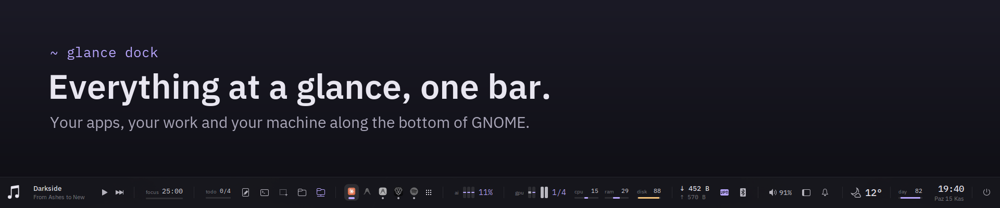
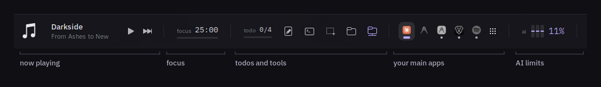
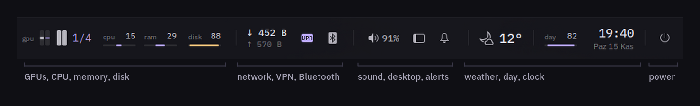

<p align="center">
  
</p>

# Glance Dock

A GNOME Shell extension that replaces the Ubuntu Dock with one bar along the bottom of the screen: your main apps towards the middle, what you're working on to the left, and your machine to the right. It hides when you're not using it and comes back when you touch the bottom edge. Everything is in IBM Plex, with every number in Plex Mono.

<p align="center">
  
  
</p>

The bar runs left to right with its spare room shared evenly between the sections. Click any section for more: a card with the details, a list, or a menu.

**Left: music, then what you're working on.**

- **Now playing**: any MPRIS player (Spotify, Firefox, Chrome, mpv). It keeps a fixed width and says "Nothing playing" when idle; click the track to bring its player forward, or to open Spotify when idle.
- **Pomodoro**: click to start or pause, right-click to reset.
- **Todos**: how many tasks you've done, with a progress bar. Click it to see, tick and add tasks.
- **Notes**: click the note icon to jot something down. Notes go to `~/Notes/Inbox.md`, and **Open in Obsidian** opens them there.
- **Terminal**: click to slide a terminal up from the bar, and click again to hide it. Right-click for your open terminals, a new one, or ssh to your machines.
- **Screenshot**: opens GNOME's screenshot tool for an area, a window or the screen, as a picture or a recording.
- **Folders**: click for Home and your Files bookmarks (including Google Drive); each opens in Files.
- **Google Drive**: from Settings → Online Accounts; click to open it in Files.

**Towards the centre: your main apps.** Claude, Antigravity IDE, Antigravity, Brave Origin and Spotify as monochrome icons that light up when you hover over them or when the app is focused. A dot marks running apps. Every other open app sits behind a `+N` button; click it to switch to one. Click an app to open or focus it, or to minimize it when it's already focused. Middle-click opens a new window, and right-click opens GNOME's app menu. The grid button shows all apps. Choose the main apps under **Main apps** in Preferences.

**Right: the system.**

- **AI limits**: drawn like the GPUs, with a thin bar per limit and the highest percentage: Claude (a rate-limit watch for Claude Code), Gemini and AG Claude (Claude and GPT-OSS models in Antigravity), and any you add yourself. Click for each limit's usage, reset time and details.
- **Compute**: your GPUs (this computer and remote machines), CPU, memory and battery meters, and the fullest drive. Click the disk meter for every drive (click one to see what fills it in Disk Usage Analyzer) and GNOME's disk tools: Disk Usage Analyzer, Disks for partitions, and System Monitor's file systems.
- **Connections**:
  - **Network**: download and upload speed.
  - **Tailscale**: whether you're connected, plus your devices; click one to copy its IP.
  - **Bluetooth**: on or off, plus your paired devices; click a device to connect it.
- **Controls**: volume (click for output and microphone sliders, scroll to change), microphone mute, show desktop, and notifications: a bell with how many are waiting (crossed out during Do Not Disturb); click it for the list, the Do Not Disturb switch and **Clear all**.
- **Time**: the weather, a meter for how much of today has passed, then the time and date.
- **Power**: lock, suspend, log out, restart or power off. The last three ask for confirmation, as GNOME's own menu does.

**Alert pill.** A pill appears when something needs your attention, such as an AI limit on pace to run out before it resets, or Claude being rate-limited. Click the pill to hide that alert.

**Details on hover.** Rings show a number and a short label. Hover over any widget for the full details.

It slides out of the way when you're not using it, and hides in fullscreen apps. It works on GNOME 46 to 50.

## Install

```sh
./install.sh
```

Log out and back in (GNOME on Wayland only picks up new extensions at login; on X11, press Alt+F2, type `r` and press Enter instead). Then enable it, and turn off the Ubuntu Dock so there's only one bar:

```sh
gnome-extensions enable glancedock@local
gnome-extensions disable ubuntu-dock@ubuntu.com
```

Open the settings with `gnome-extensions prefs glancedock@local`, or from the Extensions app. To remove it:

```sh
gnome-extensions uninstall glancedock@local
```

## Placement

The bar runs along the bottom edge of your main screen and hides itself when you're not using it. Touch the bottom edge with the pointer to bring it back. It stays up while you hover over it or have one of its menus open. To keep it visible all the time, turn off **Hide automatically** in Preferences. Maximized windows then stop above it.

If you keep the Ubuntu Dock (or Dash to Dock) on at the bottom, the bar sits just above it instead. If it ends up in the wrong place, set **Space below the bar** to a fixed number of pixels. Set it back to −1 for automatic placement.

GNOME's top bar is hidden too, and only appears in Activities (press Super). The calendar, notifications, Wi-Fi menu and tray icons (Spotify, updates and others) stay there. To keep the top bar, turn off **Hide the top bar** in Preferences.

## Weather

The weather widget uses the city from your system time zone; for example, Europe/Istanbul gives Istanbul. To pick a different city, set one in Preferences. Forecasts come from Open-Meteo, which receives only the city's coordinates.

## Todos

Click the todo tile to open its list. Click a task to tick or untick it, type in **Add a task…** and press Enter to add one, and use **Clear completed** to remove ticked tasks.

Tasks are kept in `~/.config/glancedock/todos.md`, one Markdown checkbox per line (`- [ ] task`, or `- [x] task` once done). Edit the file elsewhere and the bar updates straight away.

## Terminal

The terminal button opens a drop-up terminal centred just above the bar, 900 × 450 px. It has tabs, IBM Plex Mono, and the bar's colours.

- **Click** to show or hide it. Hiding keeps every shell running.
- **Right-click** for your open terminals (pick one to jump to it), **New terminal**, **SSH to** each machine listed under **GPUs** in Preferences, and **Quit terminal**, which closes every tab.
- New tabs start in the conda environment set under **Terminal** in Preferences (by default `mauve`), after your usual `~/.bashrc`.
- It clicks away when you click anywhere else, with your shells still running.
- In the terminal: Ctrl+Shift+T for a new tab, Ctrl+Shift+W to close one, Ctrl+Shift+C and Ctrl+Shift+V to copy and paste, Ctrl+Page Up and Ctrl+Page Down to switch tabs. The **+** button also opens a tab. Closing the last tab hides the terminal.

The terminal is a small separate program (`terminal/main.js`, GTK 3 and VTE), because GNOME Shell can't host a terminal itself. The bar starts it the first time you use it, and it keeps running on its own, so your shells survive shell restarts, screen locks and turning the extension off. To end it completely, use **Quit terminal**. It needs the `gir1.2-vte-2.91` package, which Ubuntu installs by default. Placing the panel above the bar works on X11.

## Notes

Click the note icon, type, and press Enter. Each note is added to `Inbox.md` in your notes folder (`~/Notes` unless you choose another in Preferences) as a line with the date and time. The popup lists your latest notes. Clicking one, or **Open in Obsidian**, opens the inbox in Obsidian.

Glance Dock uses an installed Obsidian, or an Obsidian AppImage in `~/Applications`, `~/Downloads` or `~/.local/bin`. It never opens notes with your default Markdown app. The first time, Obsidian asks for a vault: choose **Open folder as vault** and pick your notes folder.

## GPU

The GPU segment covers this computer and the remote machines listed under **GPUs** in Preferences (by default `aleximu`). Each GPU is a thin bar filled to its load: purple when it's free (under 10% load and under 10% memory), red at 85 °C or hotter. A dashed stub means a machine is offline. The number next to the bars is how many GPUs are free, for example `1/4`.

Click it for a card with every GPU's load, memory and temperature. Click a remote machine's name to copy `ssh <machine>`.

This computer is read every 3 seconds. Remote machines are read every 30 seconds over SSH, with key login only (`BatchMode`), so a machine that asks for a password shows as offline instead of prompting.

## AI usage

### Claude Code

The Claude ring is a rate-limit watch. It reads `ok` until Claude Code is refused because a session or weekly limit was reached. Then it turns red, shows the time until the reset (for example `2h`), and the alert pill says when you can continue. Hover over it to see today's Claude Code tokens.

It can't show how full your plan is. Claude Code only logs plan details when a request is refused, and claude.ai chats use the same limit without being logged on this computer. Logs are read from `~/.claude/projects` (or `~/.config/claude/projects`, or `$CLAUDE_CONFIG_DIR`).

### Gemini CLI

Gemini CLI chat logs are read from `~/.gemini/tmp/*/chats/`. The widget shows **Today**: the number of replies from Gemini since midnight US Pacific time, which is when Google's daily quotas reset.

Each reply is counted as one request. A reply that used tools can take more than one request behind the scenes, so the real count can be a little higher.

Set **Gemini CLI daily budget** in Preferences to your plan's daily request limit. Google has listed the free tier for personal Google accounts at 1,000 requests a day, but check your own plan, because limits change.

This covers Gemini CLI on this computer only. The Gemini app and Google AI Pro don't offer a way to read their usage limits.

If the Gemini ring stays at 0 while you're using Gemini CLI, your version may save chats somewhere else. Check with:

```sh
ls ~/.gemini/tmp/*/chats/
```

### Antigravity

While Antigravity (the IDE or the app) is open, the dock reads your real quota from it, the same numbers as its `/usage` panel. It shows two bars:

- **Gemini**: the Gemini models.
- **AG Claude**: the Claude and GPT-OSS models in Antigravity.

Each bar shows the share you've used, and the card says when it resets. Models in a group share a five-hour and a weekly limit, so the bar shows whichever is closer to running out. There's no budget to set. This is a local status query to Antigravity: it doesn't use any quota.

Until Antigravity has been opened once with Glance Dock running, a dimmed Gemini bar reminds you to open it. When Antigravity is closed, the bars stay, dimmed, showing the last reading (the card says when that was). Once a reset time has passed, that bar drops to 0%, until Antigravity is opened again and reports fresh numbers. The last reading is saved in `~/.cache/glancedock/antigravity.json`.

This uses the local service that Antigravity's own quota panel talks to. Google doesn't document it for outside apps, so an Antigravity update could break it. If that happens, only the Antigravity bars go away. Finding the service uses the `ss` command, which comes with almost every Linux system.

### Adding other services

Put any executable in `~/.config/glancedock/providers/`. It runs on every refresh (every 2 minutes by default) and must print JSON like this:

```json
{
  "id": "my-service",
  "label": "My service",
  "windows": [
    {"name": "Monthly", "used": 40, "limit": 100, "unit": "credits",
     "resets_at": "2026-12-01T00:00:00Z", "exhaust_at": null}
  ]
}
```

A script can also print a list of such objects. If you set `exhaust_at` earlier than `resets_at`, you get a run-out alert and notification.

These scripts run as your user, so only add ones you trust. Keep any API keys inside the script's own config, not in the dock.

## When the AI segment says "error"

Click it to see why. To see the full output, run the helper by hand with the system Python (it needs 3.9 or later, so not an older conda `python3`):

```sh
/usr/bin/python3 ~/.local/share/gnome-shell/extensions/glancedock@local/helpers/ai_usage.py
```

## Development

On X11, reinstall with `./install.sh` and restart GNOME Shell with Alt+F2, `r`, Enter. Your windows stay open. On Wayland, run a nested shell instead:

- **GNOME 49 and later**:
  ```sh
  dbus-run-session gnome-shell --devkit --wayland
  ```
- **GNOME 46 to 48**:
  ```sh
  dbus-run-session -- gnome-shell --nested --wayland
  ```

To watch the logs:

```sh
journalctl -f -o cat /usr/bin/gnome-shell
```

Messages from the extension start with `[Glance Dock]`.

To check the AI usage helper after changing it, run `/usr/bin/python3 helpers/test_ai_usage.py`.

To add a widget, create a class in `widgets/` that extends `Widget` from `lib/widget.js` and sets `this.actor`. Use `every(seconds, fn)` for polling, so the timers are cleaned up for you. Then:

1. Add the widget to `WIDGETS` in `extension.js`.
2. Add a `show-<key>` setting to the schema.
3. Add a switch for it in `prefs.js`.

## Known limits

- **One monitor**: the dock shows on the primary monitor only.
- **Dark only**: the dock always uses its own dark styling, whatever your system theme.
- **Local album art only**: covers that players serve from the web (Spotify does this) show a generic icon.
